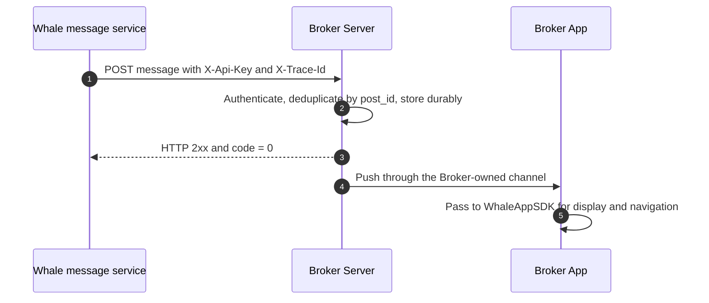

When Broker uses its own push channel, the Whale message service no longer sends push messages through the default push channels (APNs, FCM, and others). Instead, it sends the rendered messages to Broker Server through HTTP POST. Broker Server then pushes them to Broker App, and Broker App passes them to WhaleAppSDK for display and navigation.

<Note>
Whale default push and the Broker-owned push channel are mutually exclusive. You cannot push through both at the same time.
</Note>

The following table summarizes the call convention.

| Item | Convention |
| --- | --- |
| Caller | Whale message service |
| Receiver | Broker Server (endpoint supplied by Broker) |
| Method | `POST` |
| Protocol | HTTPS |
| Encoding | UTF-8, JSON, uncompressed request body |
| Channel | `push` only |
| Timeout | 30 seconds by default, configurable per Broker |
| Retry | No automatic retry on failure; see [Response and failure handling](#response) |

## Integration flow {/* integration-flow */}



<Steps>
  <Step title="Broker supplies the endpoint details">
    Supply the endpoint URLs (one for UAT and one for production) and the ApiKey. If you require signatures, also supply the ApiSecret.
  </Step>
  <Step title="Whale completes the configuration">
    Whale completes the server-side configuration per Broker (`app_id` / `account_channel`). UAT and production are configured independently.
  </Step>
  <Step title="Both parties test the integration">
    Whale sends real messages from UAT, and both parties verify receipt by `post_id` or `X-Trace-Id`.
  </Step>
  <Step title="Switch to production">
    After integration testing passes, switch to the production configuration.
  </Step>
</Steps>

## HTTP endpoint convention {/* http-endpoint-convention */}

### Request headers {/* request-headers */}

Requests from Whale carry the following headers.

| Header | Always present | Value | Description |
| --- | --- | --- | --- |
| `Content-Type` | Yes | `application/json` | No charset parameter; the encoding is always UTF-8 |
| `X-Api-Key` | Yes | The raw key supplied by Broker | Used for authentication |
| `X-Trace-Id` | Usually | 32 hexadecimal characters, for example `0123456789abcdef0123456789abcdef` | Whale trace ID; provide it during troubleshooting to locate the call. It may be empty in rare cases, so do not use it for authentication or idempotency |
| `User-Agent` | Yes | `Go-http-client/1.1` or `Go-http-client/2.0` | Default value of the HTTP client; do not use it for authentication |
| `Accept-Encoding` | Yes | `gzip` | The response may be gzip-compressed |
| `Content-Length` | Yes | Request body size in bytes | — |
| `X-Signature` | Signature mode only | See [Signature mode](#request-signature) | — |
| `X-Timestamp` | Signature mode only | Timestamp in milliseconds, for example `1794796800123` | — |
| `X-Auth-Version` | Signature mode only | `v2` | — |

### Signature mode {/* request-signature */}

Signature mode is optional. Broker can turn it on to protect against forgery or replay. The signature rule is as follows:

```txt
signature = hex( HMAC_SHA256( ApiSecret, X-Timestamp + "POST" + path + "&" + body ) )

path: the endpoint path without the domain or query, for example /whale/messages
body: the raw request body bytes, without any formatting
```

mTLS is not supported at this time.

### Network requirements {/* network-requirements */}

Whale calls Broker Server from fixed egress IP addresses, which Broker can add to an allowlist. The Whale project team provides the specific IP addresses during integration.

## Request fields {/* request-fields */}

The following fields are present in every request. All ID fields are strings, except `user_info.id`; see [user_info](#user-info).

| Field | Type | Description | Example |
| --- | --- | --- | --- |
| `member_ids` | `string[]` | `member_id` values of the recipient Clients. This is the same ID as `member_info.member.member_id` returned by Whale login. A single message has 1 entry; a batch message has up to 5000 entries. See [Recipients and batching](#recipients-and-batching) | `["10000001"]` |
| `template_key` | `string` | Template key | `"order_done_v2_lb"` |
| `post_id` | `string` | Unique message ID; see [post_id and idempotency](#post-id-idempotency) | `"600000000000000001"` |
| `channel` | `string` | Always `push` | `"push"` |
| `language` | `string` | Language used to render this message: `zh-CN`, `zh-HK`, or `en` | `"zh-CN"` |
| `title` | `string` | Rendered title | `"Buy Order Filled"` |
| `body` | `string` | Rendered body, which may contain `\n` | See the example |
| `group_id` | `int` | Message group; see [group_id values](#group-id-values) | `6` |
| `template_params` | `object` | Template parameters passed in by the business sender. The business defines the structure and types. Always an object; `{}` when there are no parameters | See [template_params](#template-params) |
| `pre_params` | `object<string,string>` | Whale built-in preset variables (institution, application, Client, and account information) that **contain personal data**. Always an object; `{}` when there are none | See [pre_params](#pre-params) |
| `user_info` | `object` | Data for WhaleAppSDK. **Pass it through completely and unchanged** | See [user_info](#user-info) |

**Empty strings**: Empty strings (`""`) in `template_params`, `pre_params`, and `user_info` are real values. They mean that the field has no value in that business scenario. For example, `cancel_qty` is `""` when an order has no canceled quantity. Do not reject the request because you treat such a value as missing or invalid.

**Unknown fields**: Whale may add fields at the top level or in `user_info`. Ignore fields you do not recognize and do not reject the request because of them.

### Generic request example {/* generic-request */}

```json
{
  "member_ids": ["<MEMBER_ID>"],
  "template_key": "<TEMPLATE_KEY>",
  "post_id": "<POST_ID>",
  "channel": "push",
  "language": "en",
  "title": "Message title",
  "body": "Message body",
  "group_id": 6,
  "template_params": {},
  "pre_params": {},
  "user_info": {
    "t": "<TEMPLATE_KEY>",
    "tn": "",
    "id": 600000000000000001,
    "lb_push_from": "{\"account_channel\":\"<ACCOUNT_CHANNEL>\",\"app_id\":\"<APP_ID>\"}",
    "link": "",
    "json": "",
    "cover": ""
  }
}
```

### template_params {/* template-params */}

`template_params` contains the raw parameters that the business sender that triggers the message (trading, funds, market data, campaigns, and others) passes in at send time. Whale uses them to render `title`, `body`, `link`, and `json`, and then **forwards them unchanged** to Broker Server. Whale does not define their structure and does not validate their types:

- **No fixed schema**: Different templates have completely different fields. The same template may also add fields, remove fields, or change types as the business evolves.
- **Inconsistent key naming**: Both camel case (`orderID`, `tickerRegion`) and snake case (`stock_counter_id`) occur. The actual input is authoritative.
- **Numeric precision**: Whale handles all numbers internally as double-precision floating-point values. An integer greater than 2^53 that is passed as a number has already lost precision when it reaches Broker Server. Business senders usually pass large integer IDs as strings, so treat ID fields as strings first. Integers are output in integer format, for example `1`, never `1.0`.

Values can be any JSON type, including nested values:

| Type | Example | Description |
| --- | --- | --- |
| String | `"qty": "500"`, `"orderID": "<ORDER_ID>"` | Most common; numbers, amounts, and IDs are also often passed as strings |
| Empty string | `"cancel_qty": ""` | A real value that means there is no value in this scenario |
| Number | `"action": 1`, `"trade_cnt": 14` | Usually an enum value or a count; may also be a decimal |
| Boolean / null | — | Business senders may pass these; your parser must accept them |
| String array | `"reasons": ["Rejected", "Please sign again and make sure that the signature is clear and legible."]` | — |
| Object (nested) | `"task_name": {"en": "net deposit", "zh-CN": "净入金", "zh-HK": "淨入金"}` | No limit on nesting depth |
| Object array | `"rewards": [{"count": 2, "name_locales": {"cn": "礼品", "en": "Gift", "hk": "禮品"}}]` | Elements can contain further nesting |
| Empty object / empty array | `"target_types": {}` | A real value |

Recommendations:

1. Store and pass through the whole value as an opaque JSON object. **Do not parse it into a strongly typed structure based on the fields of a specific template**; otherwise parsing fails when a business sender adds fields or changes types.
2. Do not validate fields for presence or type, and do not reject a request because a field is missing, empty, or has a different type.
3. You usually do not need to read `template_params`. Whale has already rendered the display text in `title` and `body`, and the navigation and business data in `user_info.link` and `user_info.json`. Read it only when Broker needs additional processing, and handle it on the assumption that a field may be absent and its type may change.
4. It may contain business data such as account numbers, order numbers, and amounts. Store it as sensitive data and do not print it in full to logs.

The following examples come from different templates and show how much the structure varies.

**Flat structure mixing strings, integers, and empty strings** (`order_done_v2_lb`, order fully filled, excerpt):

```json
{
  "action": 1,
  "qty": "500",
  "eprice": "16.0000",
  "orderID": "<ORDER_ID>",
  "orderType": "ELO",
  "timeInForce": 1,
  "cancel_qty": "",
  "multilegStrategy": 0,
  "stock_counter_id": "ST/HK/2333"
}
```

**String array** (account opening rejected):

```json
{
  "reasons": [
    "Rejected",
    "Please provide the complete address of your current or previous employer.",
    "Your occupation information is incomplete. Please provide the full company name, position, and address.",
    "Please sign again and make sure that the signature is clear and legible."
  ]
}
```

**Mix of arrays and links** (community share notification):

```json
{
  "cn": "test cn",
  "en": "test en",
  "hk": "test hk",
  "link": "lb://page/mine/message/social",
  "name": "test name",
  "avatars": ["https://example.com/avatar.png"]
}
```

**Object array with nested multi-language objects in each element** (campaign reward distribution):

```json
{
  "rewards": [
    {"count": 2, "name_locales": {"cn": "礼品", "en": "Gift", "hk": "禮品"}},
    {"count": 1, "name_locales": {"cn": "卡片", "en": "卡片", "hk": "卡片"}}
  ]
}
```

**Multi-level nesting** (campaign task enrollment, excerpt). Within the same parameters, multi-language objects use two key styles, `cn` and `zh-CN`:

```json
{
  "periods": [
    {
      "days": 1,
      "trade_cnt": 14,
      "lock_amount": "5000",
      "lock_currency": "HKD",
      "lock_end_dt": "2025-12-31",
      "min_trade_amount": "100",
      "min_trade_currency": "HKD",
      "rewards": {"cn": "耳机 x 1", "en": "Earphones x 1", "hk": "耳機 x 1"},
      "target_types": {"cn": "美股期权, 港股轮证", "en": "OPT, and WAR", "hk": "美股期權, 港股輪證"},
      "trade_markets": {"cn": "美国, 新加坡", "en": "US, and SG", "hk": "美國, 新加坡"},
      "trade_directions": {"cn": "买入/卖出", "en": "buy/sell", "hk": "買入/賣出"}
    }
  ],
  "task_name": {"en": "net deposit", "zh-CN": "净入金", "zh-HK": "淨入金"},
  "account_name": {"en": "Example Account", "zh-CN": "示例综合账户", "zh-HK": "示例綜合賬戶"},
  "lock_amount": "100",
  "lock_currency": "HKD"
}
```

**No parameters**:

```json
{}
```

### pre_params {/* pre-params */}

`pre_params` contains preset variables that Whale **fills in automatically** from the Broker configuration and the recipient's profile. Templates reference them as `pre.xxx`. The following table compares them with `template_params`.

| | `template_params` | `pre_params` |
| --- | --- | --- |
| Source | Passed in by the business sender at send time | Queried and filled in automatically by Whale from the Broker configuration and Client profile |
| Structure | Not fixed; defined by the business | **Fixed key names** defined by Whale |
| Value type | Any JSON type, may be nested | **Always strings**, no nesting |
| Empty value | May be `""`, `null`, `0`, and so on | `""` when the value is not found or not configured; **never null** |

The keys that appear depend on the business line of the message and the recipient type. They fall into four groups.

**① Institution information (Account-business messages)**

| Key | Description | Example |
| --- | --- | --- |
| `account_channel` | Account channel | `"<ACCOUNT_CHANNEL>"` |
| `org_id` | Institution ID | `"1"` |
| `org_name` | Full institution name (in the message language) | `"Example Securities Limited"` |
| `org_short_name` | Short institution name (in the message language) | `"Example Securities"` |
| `org_account_name` | Institution account name (in the message language) | `"Example Account"` |
| `org_phone_number` | Institution customer service phone number | `"+852 0000 0000"` |
| `org_check_title` | Cheque payee | `"Example Securities Limited"` |
| `org_check_description` | Cheque instructions (in the message language) | `"Example cheque instructions"` |
| `org_recipient_name` | Recipient department (in the message language) | `"Account Opening Department"` |
| `org_delivery_address` | Institution address (in the message language) | `"Example institution address"` |
| `sender_prefix` | Sender prefix (in the message language) | `"Example"` |
| `org_app_domain` | Institution App domain | `"example.com"` |
| `org_app_activity_domain` | Institution campaign page domain | `"activity.example.com"` |

**② Application information (App-business messages)**

| Key | Description | Example |
| --- | --- | --- |
| `app_id` | Application ID | `"<APP_ID>"` |
| `app_name` | Application name (in the message language) | `"Example App"` |
| `sender_prefix` | Sender prefix (in the message language) | `"Example"` |
| `app_domain` | App domain | `"example.com"` |
| `activity_domain` | Campaign page domain | `"activity.example.com"` |

**③ Client information (when the recipient is a member)**

| Key | Description | Example |
| --- | --- | --- |
| `member_id` | The Client's `member_id` | `"10000001"` |
| `member_app_id` | Application the Client belongs to | `"<APP_ID>"` |
| `member_account` | Client login account | `"<MEMBER_ACCOUNT>"` |
| `member_real_name` | Client name | `"Example Client"` |
| `member_phone_number` | Client mobile number (country code-number) | `"86-13800000000"` |
| `member_privacy_phone_number` | Masked mobile number | `"86-138****0000"` |
| `member_phone_number_suffix` | Last four digits of the mobile number | `"0000"` |
| `member_email` | Client email; `""` when not linked | `""` |
| `member_language` | Client language | `"zh-CN"` |
| `member_timezone` | Client time zone (IANA) | `"Asia/Shanghai"` |
| `member_user_region` | Client registration region | `"CN"` |

**④ Securities account information (when the recipient is a securities account; group ③ for the Client that owns the account is also included)**

| Key | Description | Example |
| --- | --- | --- |
| `account_aaid` | Securities account aaid | `"<ACCOUNT_AAID>"` |
| `account_account_no` | Securities account number | `"<ACCOUNT_NO>"` |
| `account_member_id` | ID of the Client that owns the account | `"<ACCOUNT_MEMBER_ID>"` |
| `account_org_id` | Institution the account belongs to | `"1"` |
| `account_real_name` | Account holder name | `"Example Client"` |
| `account_email` | Account email | `"client@example.com"` |
| `account_phone_number` | Account mobile number (country code-number) | `"86-13900000000"` |
| `account_privacy_phone_number` | Masked mobile number | `"86-139****0000"` |
| `account_phone_number_suffix` | Last four digits of the mobile number | `"0000"` |
| `account_language` | Account language | `"zh-CN"` |

The following table shows which groups each message type actually carries.

| Message type | Groups included |
| --- | --- |
| Account-business messages such as trading and funds (sent to a securities account) | ① + ④ + ③ |
| Account-business messages (sent to a member) | ① + ③ |
| App-business messages such as campaigns and system messages | ② + ③ |
| News (Content) messages | ③ only; `{}` in some scenarios |

Notes:

1. **Key names are fixed, but Whale may add keys.** Ignore keys you do not recognize, and do not reject a request because a key is added or missing.
2. Fields marked "in the message language" take values that match the top-level `language`. The same Broker has different values in different languages.
3. **Numbers are also strings**: `member_id`, `account_aaid`, `org_id`, and similar fields are all strings, so IDs greater than 2^53, such as `account_member_id`, do not lose precision.
4. `pre_params` contains personal data such as **names, mobile numbers, email addresses, and account numbers**. Store it as sensitive data with access control, do not print it to logs, and do not deliver it to mobile devices. The display text is already rendered into `title` and `body`, so you usually do not need to read `pre_params`.

### user_info {/* user-info */}

`user_info` is the data for WhaleAppSDK. Pass it through completely and unchanged.

| Field | Type | Description | Example |
| --- | --- | --- | --- |
| `t` | `string` | Template key, used for analytics | `"order_done_v2_lb"` |
| `tn` | `string` | Approval ticket number, used for analytics. It has a value only when the message is sent through a ticket; for most messages it is `""` | `""` |
| `id` | **`number`** | Equal to `post_id`, used for analytics. **It exceeds 2^53, so JavaScript and some JSON libraries lose precision when parsing it directly.** Parse it as a big integer, or use the top-level `post_id` string instead | `600000000000000001` |
| `lb_push_from` | `string` | JSON string that WhaleAppSDK uses to identify messages delivered by Whale | `"{\"account_channel\":\"<ACCOUNT_CHANNEL>\",\"app_id\":\"<APP_ID>\"}"` |
| `link` | `string` | Navigation target after a tap; `""` means no navigation | `"lb://page/trade/order_detail?id=<ORDER_ID>&account_channel=<ACCOUNT_CHANNEL>"` |
| `json` | `string` | Business-defined data as **JSON text** (a string, not an object), which may contain line breaks; `""` means none | See the example |
| `cover` | `string` | Cover image URL; `""` in most cases | `""` |

The `link` scheme is always one of the following three types.

| Scheme | Meaning |
| --- | --- |
| `https://` | H5 page |
| `lb://` | Whale page route, handled by WhaleAppSDK |
| `{Broker App scheme}://` | Broker App's own page route |

## post_id and idempotency {/* post-id-idempotency */}

| Item | Description |
| --- | --- |
| Format | 64-bit integer transmitted as a string, 18 to 19 digits |
| Uniqueness scope | Globally unique; never repeated across Brokers, channels, languages, or templates |
| Relationship with language | When one send targets multiple languages, it is split into one message per language, and each message has a different `post_id` |
| Relationship with recipients | One `post_id` corresponds to one request with a fixed recipient set and fixed content. The same `post_id` never carries different content |
| Number of calls | Normally each `post_id` is called only once. In extreme cases (the process restarts after sending the request but before acknowledging the internal queue message), the call may be repeated. **Make processing idempotent by `post_id`**; keeping deduplication records for 1 day or longer is sufficient |
| Resend | A manual resend is performed by the business sender sending again, which generates a new `post_id` |

## Recipients and batching {/* recipients-and-batching */}

- **Single-send templates** (trading, funds, and account notifications): one request contains only 1 member.
- **Batch templates** (campaigns, announcements, and news): recipients of the same task and the same language are placed in one request. Requests are currently **not split into batches**, with up to 5000 members per request.
- **Request size**: a single-send request is usually a few KB to a little over ten KB; a batch request with 5000 members is on the order of 100 KB.
- If you need to limit the number of recipients per request, raise it before integration. Whale then sends in batches, and each batch gets its own `post_id`.

## Response and failure handling {/* response */}

A call succeeds only when **all three** of the following conditions are met:

1. The HTTP status code is 2xx.
2. The response body is valid JSON.
3. `code == 0` or `success == true`.

```json
{
  "success": true,
  "message": "success",
  "code": 0
}
```

<Warning>
If a 2xx response body has no `code` field, it is treated as `0` and judged successful. On failure, return a non-2xx status, or return both a non-zero `code` and `success: false`.
</Warning>

The following table shows how each failure case is handled.

| Case | Whale handling |
| --- | --- |
| HTTP non-2xx | Recorded as failed; the raw response body is saved |
| 2xx but the response body is not valid JSON | Recorded as failed |
| 2xx and the JSON has `code != 0` and `success != true` | Recorded as failed; the raw response body is saved |
| Request timeout (30 seconds by default, configurable per Broker, for example 5 seconds) | Recorded as failed |
| Connection failure, TLS failure, or DNS failure | Recorded as failed |
| `429` / `503` returned | Also recorded as failed; **response headers such as `Retry-After` are not read** |

- **Failures on the push channel are not retried automatically**, and there is no failure callback.
- The result of every call (success or failure, HTTP status, raw response body, and `X-Trace-Id`) is written to the Whale send record and retained long term, and can be queried by `post_id`. For troubleshooting, contact the Whale project team.
- A timeout may also mean that Broker Server has already stored the message but the response did not reach Whale. Return success only **after durable storage**, and deduplicate by `post_id`.
- Whale does not rate-limit individual Brokers, and peaks follow business activity (such as market open and periods of concentrated fills). Reserve capacity for peak load and do not rely on `429` for rate limiting.

## group_id values {/* group-id-values */}

| `group_id` | Name |
| ---: | --- |
| 2 | Asset Movement |
| 6 | Order Status |
| 7 | Activity Related |
| 8 | Announcement |
| 9 | Account Message |
| 10 | Price Movement |
| 11 | IPO News |
| 12 | Community |
| 15 | College |
| 16 | My News |
| 17 | Today's Highlights |
| 30 | Holdings Daily |
| 31 | Market Data |
| 32 | Option Fluctuation |
| 33 | System Message |
| 34 | Dolphin Views |
| 36 | Recurring investments |

## Complete order-message example {/* complete-order-message-example */}

The following is a complete request for an order fully filled (`order_done_v2_lb`). All personal and account information is fictional.

```http
POST /whale/messages HTTP/1.1
Host: broker.example.com
Content-Type: application/json
X-Api-Key: <API_KEY>
X-Trace-Id: 0123456789abcdef0123456789abcdef
User-Agent: Go-http-client/1.1
Accept-Encoding: gzip
```

```json
{
  "member_ids": ["10000001"],
  "template_key": "order_done_v2_lb",
  "post_id": "600000000000000001",
  "channel": "push",
  "language": "en",
  "title": "Buy Order Filled",
  "body": "Security: Example Stock (02333.HK)\nFilled quantity: 500\nFilled price: 16.0000\nAccount: Example Account (<ACCOUNT_NO>)\nSide: Buy\nOrder type: Enhanced Limit\nTime in force: Day\nOrder quantity: 500\nOrder price: 13.6000\n\n\nExample Securities Limited",
  "group_id": 6,
  "template_params": {
    "st": "CS",
    "gtd": "2026.04.14T16:00:00+08:00",
    "qty": "500",
    "code": "2333",
    "doom": "2026-04-14",
    "eqty": "500",
    "price": "13.6000",
    "action": 1,
    "eprice": "16.0000",
    "orderID": "<ORDER_ID>",
    "orderTag": 1,
    "originId": "<ACCOUNT_NO>",
    "orderType": "ELO",
    "cancel_qty": "",
    "messageType": "order_done_v2_lb",
    "timeInForce": 1,
    "tickerRegion": "02333.HK",
    "accountChannel": "<ACCOUNT_CHANNEL>",
    "multilegDetail": "",
    "multilegStrategy": 0,
    "stock_counter_id": "ST/HK/2333",
    "multilegCombinedCode": ""
  },
  "pre_params": {
    "org_id": "1",
    "org_name": "Example Securities Limited",
    "org_short_name": "Example Securities",
    "org_account_name": "Example Account",
    "member_id": "10000001",
    "member_app_id": "<APP_ID>",
    "member_language": "en",
    "member_timezone": "Asia/Shanghai",
    "member_real_name": "Example Client",
    "account_aaid": "<ACCOUNT_AAID>",
    "account_channel": "<ACCOUNT_CHANNEL>",
    "account_account_no": "<ACCOUNT_NO>",
    "account_language": "en"
  },
  "user_info": {
    "t": "order_done_v2_lb",
    "tn": "",
    "id": 600000000000000001,
    "lb_push_from": "{\"account_channel\":\"<ACCOUNT_CHANNEL>\",\"app_id\":\"<APP_ID>\"}",
    "link": "lb://page/trade/order_detail?id=<ORDER_ID>&account_channel=<ACCOUNT_CHANNEL>",
    "json": "{\n  \"message_type\": \"order_done_v2_lb\",\n  \"aaid\": \"<ACCOUNT_AAID>\",\n  \"ac\": \"lb\",\n  \"need_trade_pwd\": true\n}",
    "cover": ""
  }
}
```

The `pre_params` in this example lists only some fields. Actual requests also include mobile numbers, email addresses, institution addresses, and other fields; see [pre_params](#pre-params).

## WhaleAppSDK message format {/* whaleappsdk-message-format */}

After Broker App receives a push message, it passes the message to WhaleAppSDK in the following format: `title` and `body` come from the top-level fields of the request body, and `user_info` is passed unchanged.

```json
{
  "title": "Buy Order Filled",
  "body": "Security: Example Stock (02333.HK)\nFilled quantity: 500 ...",
  "user_info": {
    "t": "order_done_v2_lb",
    "tn": "",
    "id": 600000000000000001,
    "lb_push_from": "{\"account_channel\":\"<ACCOUNT_CHANNEL>\",\"app_id\":\"<APP_ID>\"}",
    "link": "lb://page/trade/order_detail?id=<ORDER_ID>&account_channel=<ACCOUNT_CHANNEL>",
    "json": "{\n  \"message_type\": \"order_done_v2_lb\", ... }",
    "cover": ""
  }
}
```

<Warning>
Broker App must validate the `link` scheme, destination, and parameters before navigating. Never execute an unrecognized external URL directly. Unknown message types must degrade safely without crashing the App.
</Warning>

## Existing templates {/* existing-template-files */}

Broker can obtain the existing push templates in either of the following two ways, to learn in advance which messages it will receive and the title, body, and navigation configuration of each template. Both ways return the **raw templates**, which contain variables such as `{{tpl.xxx}}`. The `title`, `body`, `link`, and `json` actually pushed to Broker Server are already rendered by Whale, so Broker does not need to render them.

### Template archive {/* template-archive */}

[Download the complete template archive](/files/whalesdk/gbltpl.zip). The archive contains:

- `pre_function`: descriptions of built-in functions. Whale defines and implements the functions, and every function currently in use is in this file.
- `templates`: template definitions.
- `template_locales`: localized template content and configuration.

The archive is an export from a specific point in time and is not updated automatically when templates are added or changed later.

### Query through BrokerAPI {/* template-api */}

Use the [Global push templates](/en/broker-api/v1/whaleapi/message/whale/global/push/templates) endpoint to query online templates with pagination. The results are always current. Authentication is the same as for other BrokerAPI endpoints; see [Authentication](/en/broker-api/get-started/authentication).

The main response fields are as follows.

| Field | Description |
| --- | --- |
| `key` | Template key, corresponding to `template_key` in the push request body |
| `name` | Template name |
| `channel` | Channel |
| `group_id` | Message group, corresponding to `group_id` in the push request body |
| `locales[].language` | Language |
| `locales[].title` / `locales[].body` | Title and body templates containing `tpl.xxx` / `pre.xxx` variables |
| `locales[].configs.push_config.link` | Navigation link template; when rendered, it becomes `user_info.link` |
| `locales[].configs.push_config.json` | Business pass-through data template; when rendered, it becomes `user_info.json` |
| `locales[].configs.push_config.cover` | Cover image |
| `locales[].configs.push_config.push_device_types` | Device types to push to |

### Template variable sources {/* template-variables */}

```txt
tpl.xxx reads from template_params in the request body
pre.xxx reads from pre_params in the request body

For example, tpl.stock_counter_id in {{stock_name(tpl.stock_counter_id)}} corresponds to:
template_params: {
  stock_counter_id: "ST/US/BABA"
}
```

## FAQ {/* faq */}

**What does a success response mean?**

It means that Broker Server has received the message durably. Whale does not track whether the message is later delivered to the device.

**How do I troubleshoot a failed push?**

Provide the `post_id` or `X-Trace-Id` to the Whale project team, who can look up the HTTP status and raw response body of that call.

**Can I use Whale default push and the Broker-owned push channel at the same time?**

No. You can use only one of them.
