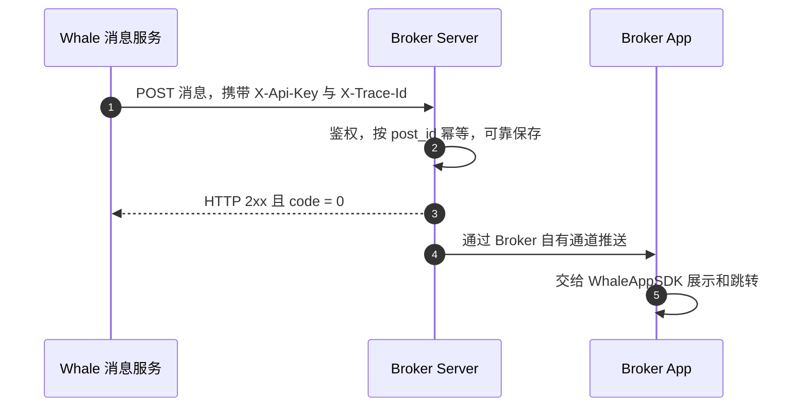

Broker 使用自有推送通道时，Whale 消息服务不再通过默认推送通道（APNs、FCM 等）推送，而是把渲染好的消息通过 HTTP POST 发给 Broker Server。Broker Server 再推送到 Broker App，由 Broker App 交给 WhaleAppSDK 展示和跳转。

<Note>
Whale 默认推送和 Broker 自有推送渠道只能二选一，不支持两边同时推送。
</Note>

下表汇总了调用约定。

| 项目 | 约定 |
| --- | --- |
| 调用方 | Whale 消息服务 |
| 接收方 | Broker Server（地址由 Broker 提供） |
| 方法 | `POST` |
| 协议 | HTTPS |
| 编码 | UTF-8，JSON，请求体不压缩 |
| 渠道 | 仅 `push` |
| 超时 | 默认 30 秒，可按 Broker 配置 |
| 重试 | 失败不自动重试，见 [响应与失败处理](#response) |

## 接入流程 {/* integration-flow */}



<Steps>
  <Step title="Broker 提供接口信息">
    提供接口地址（UAT、生产各一套）和 ApiKey；如需签名，另外提供 ApiSecret。
  </Step>
  <Step title="Whale 完成配置">
    Whale 按 Broker（`app_id` / `account_channel`）完成服务端配置，UAT 与生产相互独立。
  </Step>
  <Step title="双方联调">
    Whale 从 UAT 发送真实消息，双方按 `post_id` 或 `X-Trace-Id` 核对接收结果。
  </Step>
  <Step title="切换到生产">
    联调通过后切换到生产配置。
  </Step>
</Steps>

## HTTP 接口约定 {/* http-endpoint-convention */}

### 请求头 {/* request-headers */}

Whale 发出的请求带有以下请求头。

| 请求头 | 是否一定有 | 取值 | 说明 |
| --- | --- | --- | --- |
| `Content-Type` | 是 | `application/json` | 不带 charset，编码固定 UTF-8 |
| `X-Api-Key` | 是 | Broker 提供的密钥原文 | 用于鉴权 |
| `X-Trace-Id` | 通常有 | 32 位十六进制，例如 `0123456789abcdef0123456789abcdef` | Whale 链路 ID，排查时提供它即可定位；极少数情况下可能为空，不要用它做鉴权或幂等 |
| `User-Agent` | 是 | `Go-http-client/1.1` 或 `Go-http-client/2.0` | HTTP 客户端默认值，不要用于鉴权 |
| `Accept-Encoding` | 是 | `gzip` | 响应可以 gzip 压缩 |
| `Content-Length` | 是 | 请求体字节数 | — |
| `X-Signature` | 仅签名模式 | 见 [签名模式](#request-signature) | — |
| `X-Timestamp` | 仅签名模式 | 毫秒时间戳，例如 `1794796800123` | — |
| `X-Auth-Version` | 仅签名模式 | `v2` | — |

### 签名模式 {/* request-signature */}

签名模式是可选的。Broker 需要防伪造或防重放时可以启用，签名规则如下：

```txt
signature = hex( HMAC_SHA256( ApiSecret, X-Timestamp + "POST" + path + "&" + body ) )

path：接口路径，不含域名和 query，例如 /whale/messages
body：原始请求体字节，不做任何格式化
```

暂不支持 mTLS。

### 网络要求 {/* network-requirements */}

Whale 调用 Broker Server 的出口 IP 是固定的，Broker 可以加入白名单。具体 IP 在对接时由 Whale 项目团队提供。

## 请求字段 {/* request-fields */}

以下字段每次都会出现。ID 类字段均为字符串，`user_info.id` 除外，见 [user_info](#user-info)。

| 字段 | 类型 | 说明 | 示例 |
| --- | --- | --- | --- |
| `member_ids` | `string[]` | 收件 Client 的 `member_id`，与 Whale 登录返回的 `member_info.member.member_id` 是同一个 ID。单发消息只有 1 个；批量消息最多 5000 个，见 [收件人与批量](#recipients-and-batching) | `["10000001"]` |
| `template_key` | `string` | 模板 key | `"order_done_v2_lb"` |
| `post_id` | `string` | 消息唯一 ID，见 [post_id 与幂等](#post-id-idempotency) | `"600000000000000001"` |
| `channel` | `string` | 固定为 `push` | `"push"` |
| `language` | `string` | 本条消息渲染使用的语言：`zh-CN`、`zh-HK` 或 `en` | `"zh-CN"` |
| `title` | `string` | 渲染后的标题 | `"买入 全部成交"` |
| `body` | `string` | 渲染后的正文，可能包含 `\n` | 见示例 |
| `group_id` | `int` | 消息分组，见 [group_id 枚举](#group-id-values) | `6` |
| `template_params` | `object` | 业务方发送时传入的模板参数，结构和类型由业务决定。一定是对象，没有参数时为 `{}` | 见 [template_params](#template-params) |
| `pre_params` | `object<string,string>` | Whale 内置的预设变量（机构、应用、Client、账户信息），**包含个人信息**。一定是对象，没有时为 `{}` | 见 [pre_params](#pre-params) |
| `user_info` | `object` | 交给 WhaleAppSDK 的数据，**请完整、原样透传** | 见 [user_info](#user-info) |

**空字符串**：`template_params`、`pre_params`、`user_info` 里的空字符串（`""`）都是真实取值，表示该业务场景下这个字段没有值，比如订单没有撤单数量时 `cancel_qty` 就是 `""`。不要把它当成缺失或非法而拒收。

**未知字段**：Whale 可能在顶层或 `user_info` 中新增字段，请忽略不认识的字段，不要因此拒收。

### 通用请求示例 {/* generic-request */}

```json
{
  "member_ids": ["<MEMBER_ID>"],
  "template_key": "<TEMPLATE_KEY>",
  "post_id": "<POST_ID>",
  "channel": "push",
  "language": "zh-CN",
  "title": "消息标题",
  "body": "消息正文",
  "group_id": 6,
  "template_params": {},
  "pre_params": {},
  "user_info": {
    "t": "<TEMPLATE_KEY>",
    "tn": "",
    "id": 600000000000000001,
    "lb_push_from": "{\"account_channel\":\"<ACCOUNT_CHANNEL>\",\"app_id\":\"<APP_ID>\"}",
    "link": "",
    "json": "",
    "cover": ""
  }
}
```

### template_params {/* template-params */}

`template_params` 是触发消息的业务方（交易、资金、行情、运营活动等）在发送时传入的原始参数。Whale 用它渲染 `title`、`body`、`link` 和 `json`，然后**原样转发**给 Broker Server。Whale 不定义它的结构，也不做类型校验：

- **没有固定 schema**：不同模板的字段完全不同；同一模板也可能随业务迭代增加、删除字段或改变类型。
- **键名风格不统一**：驼峰（`orderID`、`tickerRegion`）和下划线（`stock_counter_id`）都有，以实际传入为准。
- **数字精度**：Whale 内部把所有数字当作双精度浮点数处理，超过 2^53 的整数如果以 number 形式传入，到达 Broker Server 时已经丢失精度。业务方的大整数 ID 一般用字符串传，遇到 ID 类字段请优先按字符串理解。整数按整数格式输出，例如 `1`，不会变成 `1.0`。

值可以是任意 JSON 类型，包括嵌套：

| 类型 | 示例 | 说明 |
| --- | --- | --- |
| 字符串 | `"qty": "500"`、`"orderID": "<ORDER_ID>"` | 最常见；数字、金额、ID 也经常以字符串传入 |
| 空字符串 | `"cancel_qty": ""` | 真实取值，表示该场景下没有值 |
| 数字 | `"action": 1`、`"trade_cnt": 14` | 多为枚举值或计数，也可能是小数 |
| 布尔 / null | — | 业务方可以传，需要兼容 |
| 字符串数组 | `"reasons": ["驳回", "请您重新签名，请确保签名清晰可识别。"]` | — |
| 对象（嵌套） | `"task_name": {"en": "net deposit", "zh-CN": "净入金", "zh-HK": "淨入金"}` | 嵌套层数不限 |
| 对象数组 | `"rewards": [{"count": 2, "name_locales": {"cn": "礼品", "en": "Gift", "hk": "禮品"}}]` | 元素里还可以继续嵌套 |
| 空对象 / 空数组 | `"target_types": {}` | 真实取值 |

处理建议：

1. 整体当作不透明的 JSON 对象保存和透传，**不要按某个模板的字段建强类型结构去解析**，否则业务方新增字段或改类型时会解析失败。
2. 不要对字段做必填或类型校验，不要因为字段缺失、为空或类型变化而拒收。
3. 一般不需要读取 `template_params`：展示用的 `title`、`body`，以及跳转和业务数据 `user_info.link`、`user_info.json` 都已由 Whale 渲染好。只有 Broker 要做二次加工时才需要读取，并且要按“字段可能不存在、类型可能变化”来处理。
4. 其中可能有账户号、订单号、金额等业务数据，请按敏感数据保存，不要完整打印到日志里。

以下示例来自不同模板，可以看出结构差别很大。

**平铺结构，字符串、整数、空字符串混用**（`order_done_v2_lb` 订单全部成交，节选）：

```json
{
  "action": 1,
  "qty": "500",
  "eprice": "16.0000",
  "orderID": "<ORDER_ID>",
  "orderType": "ELO",
  "timeInForce": 1,
  "cancel_qty": "",
  "multilegStrategy": 0,
  "stock_counter_id": "ST/HK/2333"
}
```

**字符串数组**（开户驳回）：

```json
{
  "reasons": [
    "驳回",
    "请重新填写完整您当前任职或曾任职公司地址。",
    "您的职业信息不完全，请填写详细，完整的公司名称、职位及地址。",
    "请您重新签名，请确保签名清晰可识别。"
  ]
}
```

**数组与链接混合**（社区分享通知）：

```json
{
  "cn": "test cn",
  "en": "test en",
  "hk": "test hk",
  "link": "lb://page/mine/message/social",
  "name": "test name",
  "avatars": ["https://example.com/avatar.png"]
}
```

**对象数组，元素里再嵌套多语言对象**（活动奖励发放）：

```json
{
  "rewards": [
    {"count": 2, "name_locales": {"cn": "礼品", "en": "Gift", "hk": "禮品"}},
    {"count": 1, "name_locales": {"cn": "卡片", "en": "卡片", "hk": "卡片"}}
  ]
}
```

**多层嵌套**（活动任务报名，节选）。同一份参数里多语言对象的键名有 `cn` 和 `zh-CN` 两种风格：

```json
{
  "periods": [
    {
      "days": 1,
      "trade_cnt": 14,
      "lock_amount": "5000",
      "lock_currency": "HKD",
      "lock_end_dt": "2025-12-31",
      "min_trade_amount": "100",
      "min_trade_currency": "HKD",
      "rewards": {"cn": "耳机 x 1", "en": "Earphones x 1", "hk": "耳機 x 1"},
      "target_types": {"cn": "美股期权, 港股轮证", "en": "OPT, and WAR", "hk": "美股期權, 港股輪證"},
      "trade_markets": {"cn": "美国, 新加坡", "en": "US, and SG", "hk": "美國, 新加坡"},
      "trade_directions": {"cn": "买入/卖出", "en": "buy/sell", "hk": "買入/賣出"}
    }
  ],
  "task_name": {"en": "net deposit", "zh-CN": "净入金", "zh-HK": "淨入金"},
  "account_name": {"en": "Example Account", "zh-CN": "示例综合账户", "zh-HK": "示例綜合賬戶"},
  "lock_amount": "100",
  "lock_currency": "HKD"
}
```

**无参数**：

```json
{}
```

### pre_params {/* pre-params */}

`pre_params` 是 Whale 根据 Broker 配置和收件人资料**自动补充**的预设变量，模板里用 `pre.xxx` 引用。它和 `template_params` 的区别如下。

| | `template_params` | `pre_params` |
| --- | --- | --- |
| 来源 | 业务方发送时传入 | Whale 按 Broker 配置、Client 资料自动查询填充 |
| 结构 | 不固定，由业务决定 | **键名固定**，由 Whale 定义 |
| 值类型 | 任意 JSON 类型，可嵌套 | **全部是字符串**，没有嵌套 |
| 空值 | 可能是 `""`、`null`、`0` 等 | 查不到或未配置时为 `""`，**不会是 null** |

出现哪些键取决于消息所属业务线和收件人类型，分为四组。

**① 机构信息（Account 业务的消息）**

| 键 | 说明 | 示例 |
| --- | --- | --- |
| `account_channel` | 账户渠道 | `"<ACCOUNT_CHANNEL>"` |
| `org_id` | 机构 ID | `"1"` |
| `org_name` | 机构全称（按消息语言） | `"示例证券有限公司"` |
| `org_short_name` | 机构简称（按消息语言） | `"示例证券"` |
| `org_account_name` | 机构账户名称（按消息语言） | `"示例综合账户"` |
| `org_phone_number` | 机构客服电话 | `"+852 0000 0000"` |
| `org_check_title` | 支票抬头 | `"Example Securities Limited"` |
| `org_check_description` | 支票说明（按消息语言） | `"示例支票说明"` |
| `org_recipient_name` | 收件部门（按消息语言） | `"开户部"` |
| `org_delivery_address` | 机构地址（按消息语言） | `"示例机构地址"` |
| `sender_prefix` | 发送方前缀（按消息语言） | `"Example"` |
| `org_app_domain` | 机构 App 域名 | `"example.com"` |
| `org_app_activity_domain` | 机构活动页域名 | `"activity.example.com"` |

**② 应用信息（App 业务的消息）**

| 键 | 说明 | 示例 |
| --- | --- | --- |
| `app_id` | 应用 ID | `"<APP_ID>"` |
| `app_name` | 应用名称（按消息语言） | `"示例 App"` |
| `sender_prefix` | 发送方前缀（按消息语言） | `"Example"` |
| `app_domain` | App 域名 | `"example.com"` |
| `activity_domain` | 活动页域名 | `"activity.example.com"` |

**③ Client 信息（收件人是 member 时）**

| 键 | 说明 | 示例 |
| --- | --- | --- |
| `member_id` | Client 的 `member_id` | `"10000001"` |
| `member_app_id` | Client 所属应用 | `"<APP_ID>"` |
| `member_account` | Client 登录账号 | `"<MEMBER_ACCOUNT>"` |
| `member_real_name` | Client 姓名 | `"示例客户"` |
| `member_phone_number` | Client 手机号（区号-号码） | `"86-13800000000"` |
| `member_privacy_phone_number` | 打码后的手机号 | `"86-138****0000"` |
| `member_phone_number_suffix` | 手机号后四位 | `"0000"` |
| `member_email` | Client 邮箱，未绑定时为 `""` | `""` |
| `member_language` | Client 语言 | `"zh-CN"` |
| `member_timezone` | Client 时区（IANA） | `"Asia/Shanghai"` |
| `member_user_region` | Client 注册地区 | `"CN"` |

**④ 证券账户信息（收件人是证券账户时，会同时带上该账户所属 Client 的 ③）**

| 键 | 说明 | 示例 |
| --- | --- | --- |
| `account_aaid` | 证券账户 aaid | `"<ACCOUNT_AAID>"` |
| `account_account_no` | 证券账户号 | `"<ACCOUNT_NO>"` |
| `account_member_id` | 账户所属 Client 的 ID | `"<ACCOUNT_MEMBER_ID>"` |
| `account_org_id` | 账户所属机构 | `"1"` |
| `account_real_name` | 账户持有人姓名 | `"示例客户"` |
| `account_email` | 账户邮箱 | `"client@example.com"` |
| `account_phone_number` | 账户手机号（区号-号码） | `"86-13900000000"` |
| `account_privacy_phone_number` | 打码后的手机号 | `"86-139****0000"` |
| `account_phone_number_suffix` | 手机号后四位 | `"0000"` |
| `account_language` | 账户语言 | `"zh-CN"` |

各类消息实际带有的分组如下。

| 消息类型 | 带有的分组 |
| --- | --- |
| 交易、资金等 Account 业务消息（发给证券账户） | ① + ④ + ③ |
| Account 业务消息（发给 member） | ① + ③ |
| 运营、系统等 App 业务消息 | ② + ③ |
| 资讯类（Content）消息 | 只有 ③，部分场景为 `{}` |

注意事项：

1. **键名固定，但 Whale 可能新增键**。请忽略不认识的键，不要因为多了或少了某个键而拒收。
2. 标注“按消息语言”的字段，取值与顶层 `language` 一致；同一个 Broker 在不同语言下取值不同。
3. **数字也是字符串**：`member_id`、`account_aaid`、`org_id` 等都是字符串，`account_member_id` 这类超过 2^53 的 ID 不会丢失精度。
4. `pre_params` 包含**姓名、手机号、邮箱、账户号**等个人信息，请按敏感数据保存和控制访问，不要打印到日志里，也不要下发到手机端。展示用的文案已渲染进 `title` 和 `body`，一般不需要再读取 `pre_params`。

### user_info {/* user-info */}

`user_info` 是交给 WhaleAppSDK 的数据，请完整、原样透传。

| 字段 | 类型 | 说明 | 示例 |
| --- | --- | --- | --- |
| `t` | `string` | 模板 key，用于埋点 | `"order_done_v2_lb"` |
| `tn` | `string` | 审批工单号，用于埋点。通过工单发送时才有值，大部分消息为 `""` | `""` |
| `id` | **`number`** | 等于 `post_id`，用于埋点。**超过 2^53，JavaScript 或部分 JSON 库直接解析会丢失精度**，请用大整数方式解析，或改用顶层的 `post_id` 字符串 | `600000000000000001` |
| `lb_push_from` | `string` | JSON 字符串，WhaleAppSDK 用它识别 Whale 下发的消息 | `"{\"account_channel\":\"<ACCOUNT_CHANNEL>\",\"app_id\":\"<APP_ID>\"}"` |
| `link` | `string` | 点击后的跳转地址；`""` 表示不跳转 | `"lb://page/trade/order_detail?id=<ORDER_ID>&account_channel=<ACCOUNT_CHANNEL>"` |
| `json` | `string` | 业务自定义数据，是一段 **JSON 文本**（字符串，不是对象），可能带换行；`""` 表示没有 | 见示例 |
| `cover` | `string` | 封面图 URL，大部分为 `""` | `""` |

`link` 的 scheme 只会是以下三类之一。

| scheme | 含义 |
| --- | --- |
| `https://` | H5 页面 |
| `lb://` | Whale 页面路由，交给 WhaleAppSDK 处理 |
| `{Broker App scheme}://` | Broker App 自有页面路由 |

## post_id 与幂等 {/* post-id-idempotency */}

| 项目 | 说明 |
| --- | --- |
| 格式 | 64 位整数，以字符串传输，18～19 位数字 |
| 唯一范围 | 全局唯一，跨 Broker、渠道、语言、模板都不重复 |
| 与语言的关系 | 一次发送命中多种语言时，按语言拆成多条消息，每条消息的 `post_id` 不同 |
| 与收件人的关系 | 一个 `post_id` 对应一次请求，收件人集合和内容固定，不会出现同一 `post_id` 内容不同的情况 |
| 调用次数 | 正常情况下每个 `post_id` 只调用一次。极端情况（发出请求后、确认内部队列消息前进程重启）可能重复调用，**请按 `post_id` 做幂等**，去重记录保留 1 天以上即可 |
| 补发 | 人工补发由业务方重新发送，会生成新的 `post_id` |

## 收件人与批量 {/* recipients-and-batching */}

- **单发模板**（交易、资金、账户类通知）：一个请求只有 1 个 member。
- **批量模板**（运营、公告、资讯类）：同一任务、同一语言的收件人放在一个请求里，目前**不分批**，单次最多 5000 个 member。
- **请求大小**：单发通常在几 KB 到十几 KB；批量带 5000 个 member 时约为 100 KB 量级。
- 如需限制单个请求的收件人数，请在对接前提出，由 Whale 分批发送，届时每批生成独立的 `post_id`。

## 响应与失败处理 {/* response */}

以下三个条件**同时满足**才算成功：

1. HTTP 状态码为 2xx。
2. 响应体是合法 JSON。
3. `code == 0` 或 `success == true`。

```json
{
  "success": true,
  "message": "success",
  "code": 0
}
```

<Warning>
2xx 响应体中如果没有 `code` 字段，会按 `0` 处理并判为成功。失败时请返回非 2xx，或者同时返回非零 `code` 和 `success: false`。
</Warning>

各类失败情况的处理如下。

| 情况 | Whale 处理 |
| --- | --- |
| HTTP 非 2xx | 记为失败，保存原始响应体 |
| 2xx 但响应体不是合法 JSON | 记为失败 |
| 2xx 且 JSON 中 `code != 0` 且 `success != true` | 记为失败，保存原始响应体 |
| 请求超时（默认 30 秒，可按 Broker 配置，例如 5 秒） | 记为失败 |
| 连接失败、TLS 失败、DNS 失败 | 记为失败 |
| 返回 `429` / `503` | 同样记为失败；**不读取 `Retry-After` 等响应头** |

- **push 渠道失败不自动重试**，也没有失败回调。
- 每次调用的结果（成功或失败、HTTP 状态、原始响应体、`X-Trace-Id`）都写入 Whale 发送记录并长期保存，可以按 `post_id` 查询；排查时请联系 Whale 项目团队。
- 超时也可能是 Broker Server 已经保存、但响应没有回到 Whale，所以请在**可靠保存后**再返回成功，并按 `post_id` 去重。
- Whale 不对单个 Broker 限速，峰值跟随业务（如开盘、成交集中时段）。请按峰值预留容量，不要依赖 `429` 限流。

## group_id 枚举 {/* group-id-values */}

| `group_id` | 中文名称 | 英文名称 |
| ---: | --- | --- |
| 2 | 资金变动 | Asset Movement |
| 6 | 交易变动 | Order Status |
| 7 | 运营活动 | Activity Related |
| 8 | 平台公告 | Announcement |
| 9 | 账户消息 | Account Message |
| 10 | 股价提醒 | Price Movement |
| 11 | 新股消息 | IPO News |
| 12 | 社区消息 | Community |
| 15 | 学堂 | College |
| 16 | 我的资讯 | My News |
| 17 | 今日看点 | Today's Highlights |
| 30 | 持仓日报 | Holdings Daily |
| 31 | 行情数据 | Market Data |
| 32 | 期权异动 | Option Fluctuation |
| 33 | 系统消息 | System Message |
| 34 | 海豚观点 | Dolphin Views |
| 36 | 股票定投 | Recurring investments |

## 完整订单消息示例 {/* complete-order-message-example */}

以下是订单全部成交（`order_done_v2_lb`）的完整请求，所有个人和账户信息均为虚构值。

```http
POST /whale/messages HTTP/1.1
Host: broker.example.com
Content-Type: application/json
X-Api-Key: <API_KEY>
X-Trace-Id: 0123456789abcdef0123456789abcdef
User-Agent: Go-http-client/1.1
Accept-Encoding: gzip
```

```json
{
  "member_ids": ["10000001"],
  "template_key": "order_done_v2_lb",
  "post_id": "600000000000000001",
  "channel": "push",
  "language": "zh-CN",
  "title": "买入 全部成交",
  "body": "股票名称：示例股票（02333.HK）\n成交数量：500\n成交价格：16.0000\n账户：示例综合账户（<ACCOUNT_NO>）\n交易方向：买入\n订单类型：增强限价单\n有效期：当日有效\n委托数量：500\n委托价格：13.6000\n\n\n示例证券有限公司",
  "group_id": 6,
  "template_params": {
    "st": "CS",
    "gtd": "2026.04.14T16:00:00+08:00",
    "qty": "500",
    "code": "2333",
    "doom": "2026-04-14",
    "eqty": "500",
    "price": "13.6000",
    "action": 1,
    "eprice": "16.0000",
    "orderID": "<ORDER_ID>",
    "orderTag": 1,
    "originId": "<ACCOUNT_NO>",
    "orderType": "ELO",
    "cancel_qty": "",
    "messageType": "order_done_v2_lb",
    "timeInForce": 1,
    "tickerRegion": "02333.HK",
    "accountChannel": "<ACCOUNT_CHANNEL>",
    "multilegDetail": "",
    "multilegStrategy": 0,
    "stock_counter_id": "ST/HK/2333",
    "multilegCombinedCode": ""
  },
  "pre_params": {
    "org_id": "1",
    "org_name": "示例证券有限公司",
    "org_short_name": "示例证券",
    "org_account_name": "示例综合账户",
    "member_id": "10000001",
    "member_app_id": "<APP_ID>",
    "member_language": "zh-CN",
    "member_timezone": "Asia/Shanghai",
    "member_real_name": "示例客户",
    "account_aaid": "<ACCOUNT_AAID>",
    "account_channel": "<ACCOUNT_CHANNEL>",
    "account_account_no": "<ACCOUNT_NO>",
    "account_language": "zh-CN"
  },
  "user_info": {
    "t": "order_done_v2_lb",
    "tn": "",
    "id": 600000000000000001,
    "lb_push_from": "{\"account_channel\":\"<ACCOUNT_CHANNEL>\",\"app_id\":\"<APP_ID>\"}",
    "link": "lb://page/trade/order_detail?id=<ORDER_ID>&account_channel=<ACCOUNT_CHANNEL>",
    "json": "{\n  \"message_type\": \"order_done_v2_lb\",\n  \"aaid\": \"<ACCOUNT_AAID>\",\n  \"ac\": \"lb\",\n  \"need_trade_pwd\": true\n}",
    "cover": ""
  }
}
```

示例中的 `pre_params` 只列出了部分字段，实际还会包含手机号、邮箱、机构地址等，见 [pre_params](#pre-params)。

## SDK 消息对接格式 {/* whaleappsdk-message-format */}

Broker App 收到推送后，按以下格式交给 WhaleAppSDK：`title`、`body` 取请求体顶层字段，`user_info` 原样传入。

```json
{
  "title": "买入 全部成交",
  "body": "股票名称：示例股票（02333.HK）\n成交数量：500 ...",
  "user_info": {
    "t": "order_done_v2_lb",
    "tn": "",
    "id": 600000000000000001,
    "lb_push_from": "{\"account_channel\":\"<ACCOUNT_CHANNEL>\",\"app_id\":\"<APP_ID>\"}",
    "link": "lb://page/trade/order_detail?id=<ORDER_ID>&account_channel=<ACCOUNT_CHANNEL>",
    "json": "{\n  \"message_type\": \"order_done_v2_lb\", ... }",
    "cover": ""
  }
}
```

<Warning>
Broker App 必须校验 `link` 的 scheme、目标和参数后再跳转，不能直接执行未识别的外部 URL。未知消息类型应安全降级，不应导致 App 崩溃。
</Warning>

## 已有模板 {/* existing-template-files */}

Broker 可以通过以下两种方式获取现有的推送模板，提前了解会收到哪些消息，以及各模板的标题、正文和跳转配置。两种方式拿到的都是**模板原文**，其中包含 `{{tpl.xxx}}` 这类变量；实际推送给 Broker Server 的 `title`、`body`、`link`、`json` 已由 Whale 渲染完成，Broker 不需要自行渲染。

### 模板压缩包 {/* template-archive */}

[下载完整模板文件](/files/whalesdk/gbltpl.zip)，压缩包包含：

- `pre_function`：内置函数说明。函数由 Whale 定义并实现，目前用到的函数都在文件中。
- `templates`：模板定义。
- `template_locales`：模板多语言内容及配置。

压缩包是某个时间点的导出，模板后续新增或修改时不会自动更新。

### 通过 BrokerAPI 查询 {/* template-api */}

通过 [全局推送模板](/zh-cn/broker-api/v1/whaleapi/message/whale/global/push/templates) 接口分页查询线上模板，结果始终是最新的。鉴权方式与其他 BrokerAPI 接口相同，见 [认证](/zh-cn/broker-api/get-started/authentication)。

返回的主要字段如下。

| 字段 | 说明 |
| --- | --- |
| `key` | 模板 key，对应推送请求体里的 `template_key` |
| `name` | 模板名称 |
| `channel` | 渠道 |
| `group_id` | 消息分组，对应推送请求体里的 `group_id` |
| `locales[].language` | 语言 |
| `locales[].title` / `locales[].body` | 标题和正文模板，包含 `tpl.xxx` / `pre.xxx` 变量 |
| `locales[].configs.push_config.link` | 跳转链接模板，渲染后就是 `user_info.link` |
| `locales[].configs.push_config.json` | 业务透传数据模板，渲染后就是 `user_info.json` |
| `locales[].configs.push_config.cover` | 封面图 |
| `locales[].configs.push_config.push_device_types` | 推送的设备类型 |

### 模板变量来源 {/* template-variables */}

```txt
tpl.xxx 取自请求体的 template_params
pre.xxx 取自请求体的 pre_params

例如 {{stock_name(tpl.stock_counter_id)}} 中的 tpl.stock_counter_id，对应：
template_params: {
  stock_counter_id: "ST/US/BABA"
}
```

## 常见问题 {/* faq */}

**返回成功代表什么？**

代表 Broker Server 已可靠接收。Whale 不跟踪后续消息是否送达设备。

**推送失败如何排查？**

把 `post_id` 或 `X-Trace-Id` 提供给 Whale 项目团队，可以查到这次调用的 HTTP 状态和原始响应体。

**能否同时使用 Whale 默认推送和 Broker 自有推送渠道？**

不能，二者只能选一个。
