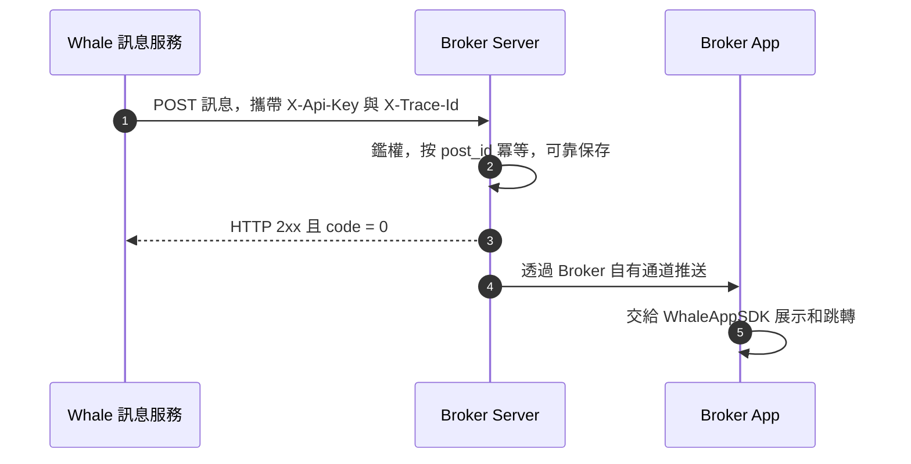

Broker 使用自有推送通道時，Whale 訊息服務不再透過預設推送通道（APNs、FCM 等）推送，而是把渲染好的訊息透過 HTTP POST 發給 Broker Server。Broker Server 再推送到 Broker App，由 Broker App 交給 WhaleAppSDK 展示和跳轉。

<Note>
Whale 預設推送和 Broker 自有推送渠道只能二選一，不支援兩邊同時推送。
</Note>

下表彙總了呼叫約定。

| 項目 | 約定 |
| --- | --- |
| 呼叫方 | Whale 訊息服務 |
| 接收方 | Broker Server（地址由 Broker 提供） |
| 方法 | `POST` |
| 協定 | HTTPS |
| 編碼 | UTF-8，JSON，請求體不壓縮 |
| 渠道 | 僅 `push` |
| 超時 | 預設 30 秒，可按 Broker 配置 |
| 重試 | 失敗不自動重試，見 [響應與失敗處理](#response) |

## 接入流程 {/* integration-flow */}



<Steps>
  <Step title="Broker 提供介面資訊">
    提供介面地址（UAT、生產各一套）和 ApiKey；如需簽名，另外提供 ApiSecret。
  </Step>
  <Step title="Whale 完成配置">
    Whale 按 Broker（`app_id` / `account_channel`）完成服務端配置，UAT 與生產互相獨立。
  </Step>
  <Step title="雙方聯調">
    Whale 從 UAT 發送真實訊息，雙方按 `post_id` 或 `X-Trace-Id` 核對接收結果。
  </Step>
  <Step title="切換到生產">
    聯調通過後切換到生產配置。
  </Step>
</Steps>

## HTTP 介面約定 {/* http-endpoint-convention */}

### 請求頭 {/* request-headers */}

Whale 發出的請求帶有以下請求頭。

| 請求頭 | 是否一定有 | 取值 | 說明 |
| --- | --- | --- | --- |
| `Content-Type` | 是 | `application/json` | 不帶 charset，編碼固定為 UTF-8 |
| `X-Api-Key` | 是 | Broker 提供的金鑰原文 | 用於鑑權 |
| `X-Trace-Id` | 通常有 | 32 位十六進制，例如 `0123456789abcdef0123456789abcdef` | Whale 鏈路 ID，排查時提供它即可定位；極少數情況下可能為空，不要用它做鑑權或冪等 |
| `User-Agent` | 是 | `Go-http-client/1.1` 或 `Go-http-client/2.0` | HTTP 客戶端預設值，不要用於鑑權 |
| `Accept-Encoding` | 是 | `gzip` | 響應可以 gzip 壓縮 |
| `Content-Length` | 是 | 請求體位元組數 | — |
| `X-Signature` | 僅簽名模式 | 見 [簽名模式](#request-signature) | — |
| `X-Timestamp` | 僅簽名模式 | 毫秒時間戳，例如 `1794796800123` | — |
| `X-Auth-Version` | 僅簽名模式 | `v2` | — |

### 簽名模式 {/* request-signature */}

簽名模式是可選的。Broker 需要防偽造或防重放時可以啟用，簽名規則如下：

```txt
signature = hex( HMAC_SHA256( ApiSecret, X-Timestamp + "POST" + path + "&" + body ) )

path：介面路徑，不含域名和 query，例如 /whale/messages
body：原始請求體位元組，不做任何格式化
```

暫不支援 mTLS。

### 網路要求 {/* network-requirements */}

Whale 呼叫 Broker Server 的出口 IP 是固定的，Broker 可以加入白名單。具體 IP 在對接時由 Whale 專案團隊提供。

## 請求欄位 {/* request-fields */}

以下欄位每次都會出現。ID 類欄位均為字串，`user_info.id` 除外，見 [user_info](#user-info)。

| 欄位 | 類型 | 說明 | 示例 |
| --- | --- | --- | --- |
| `member_ids` | `string[]` | 收件 Client 的 `member_id`，與 Whale 登入返回的 `member_info.member.member_id` 是同一個 ID。單發訊息只有 1 個；批量訊息最多 5000 個，見 [收件人與批量](#recipients-and-batching) | `["10000001"]` |
| `template_key` | `string` | 模板 key | `"order_done_v2_lb"` |
| `post_id` | `string` | 訊息唯一 ID，見 [post_id 與冪等](#post-id-idempotency) | `"600000000000000001"` |
| `channel` | `string` | 固定為 `push` | `"push"` |
| `language` | `string` | 本條訊息渲染使用的語言：`zh-CN`、`zh-HK` 或 `en` | `"zh-CN"` |
| `title` | `string` | 渲染後的標題 | `"買入 全部成交"` |
| `body` | `string` | 渲染後的正文，可能包含 `\n` | 見示例 |
| `group_id` | `int` | 訊息分組，見 [group_id 枚舉](#group-id-values) | `6` |
| `template_params` | `object` | 業務方發送時傳入的模板參數，結構和類型由業務決定。一定是物件，沒有參數時為 `{}` | 見 [template_params](#template-params) |
| `pre_params` | `object<string,string>` | Whale 內建的預設變數（機構、應用、Client、帳戶資訊），**包含個人資料**。一定是物件，沒有時為 `{}` | 見 [pre_params](#pre-params) |
| `user_info` | `object` | 交給 WhaleAppSDK 的資料，**請完整、原樣透傳** | 見 [user_info](#user-info) |

**空字串**：`template_params`、`pre_params`、`user_info` 裏的空字串（`""`）都是真實取值，表示該業務場景下這個欄位沒有值，例如訂單沒有撤單數量時 `cancel_qty` 就是 `""`。不要把它當成缺失或非法而拒收。

**未知欄位**：Whale 可能在頂層或 `user_info` 中新增欄位，請忽略不認識的欄位，不要因此拒收。

### 通用請求示例 {/* generic-request */}

```json
{
  "member_ids": ["<MEMBER_ID>"],
  "template_key": "<TEMPLATE_KEY>",
  "post_id": "<POST_ID>",
  "channel": "push",
  "language": "zh-CN",
  "title": "訊息標題",
  "body": "訊息正文",
  "group_id": 6,
  "template_params": {},
  "pre_params": {},
  "user_info": {
    "t": "<TEMPLATE_KEY>",
    "tn": "",
    "id": 600000000000000001,
    "lb_push_from": "{\"account_channel\":\"<ACCOUNT_CHANNEL>\",\"app_id\":\"<APP_ID>\"}",
    "link": "",
    "json": "",
    "cover": ""
  }
}
```

### template_params {/* template-params */}

`template_params` 是觸發訊息的業務方（交易、資金、行情、營運活動等）在發送時傳入的原始參數。Whale 用它渲染 `title`、`body`、`link` 和 `json`，然後**原樣轉發**給 Broker Server。Whale 不定義它的結構，也不做類型校驗：

- **沒有固定 schema**：不同模板的欄位完全不同；同一模板也可能隨業務迭代增加、刪除欄位或改變類型。
- **鍵名風格不統一**：駝峰（`orderID`、`tickerRegion`）和底線（`stock_counter_id`）都有，以實際傳入為準。
- **數字精度**：Whale 內部把所有數字當作雙精度浮點數處理，超過 2^53 的整數如果以 number 形式傳入，到達 Broker Server 時已經丟失精度。業務方的大整數 ID 一般用字串傳，遇到 ID 類欄位請優先按字串理解。整數按整數格式輸出，例如 `1`，不會變成 `1.0`。

值可以是任意 JSON 類型，包括巢狀結構：

| 類型 | 示例 | 說明 |
| --- | --- | --- |
| 字串 | `"qty": "500"`、`"orderID": "<ORDER_ID>"` | 最常見；數字、金額、ID 也經常以字串傳入 |
| 空字串 | `"cancel_qty": ""` | 真實取值，表示該場景下沒有值 |
| 數字 | `"action": 1`、`"trade_cnt": 14` | 多為枚舉值或計數，也可能是小數 |
| 布林 / null | — | 業務方可以傳，需要相容 |
| 字串陣列 | `"reasons": ["駁回", "請您重新簽名，請確保簽名清晰可識別。"]` | — |
| 物件（巢狀） | `"task_name": {"en": "net deposit", "zh-CN": "净入金", "zh-HK": "淨入金"}` | 巢狀層數不限 |
| 物件陣列 | `"rewards": [{"count": 2, "name_locales": {"cn": "礼品", "en": "Gift", "hk": "禮品"}}]` | 元素裏還可以繼續巢狀 |
| 空物件 / 空陣列 | `"target_types": {}` | 真實取值 |

處理建議：

1. 整體當作不透明的 JSON 物件保存和透傳，**不要按某個模板的欄位建立強類型結構去解析**，否則業務方新增欄位或改類型時會解析失敗。
2. 不要對欄位做必填或類型校驗，不要因為欄位缺失、為空或類型變化而拒收。
3. 一般不需要讀取 `template_params`：展示用的 `title`、`body`，以及跳轉和業務資料 `user_info.link`、`user_info.json` 都已由 Whale 渲染好。只有 Broker 要做二次加工時才需要讀取，並且要按「欄位可能不存在、類型可能變化」來處理。
4. 其中可能有帳戶號碼、訂單號、金額等業務資料，請按敏感資料保存，不要完整寫入日誌。

以下示例來自不同模板，可以看出結構差別很大。

**平鋪結構，字串、整數、空字串混用**（`order_done_v2_lb` 訂單全部成交，節選）：

```json
{
  "action": 1,
  "qty": "500",
  "eprice": "16.0000",
  "orderID": "<ORDER_ID>",
  "orderType": "ELO",
  "timeInForce": 1,
  "cancel_qty": "",
  "multilegStrategy": 0,
  "stock_counter_id": "ST/HK/2333"
}
```

**字串陣列**（開戶駁回）：

```json
{
  "reasons": [
    "駁回",
    "請重新填寫完整您當前任職或曾任職公司地址。",
    "您的職業資料不完整，請詳細填寫完整的公司名稱、職位及地址。",
    "請您重新簽名，請確保簽名清晰可識別。"
  ]
}
```

**陣列與連結混合**（社區分享通知）：

```json
{
  "cn": "test cn",
  "en": "test en",
  "hk": "test hk",
  "link": "lb://page/mine/message/social",
  "name": "test name",
  "avatars": ["https://example.com/avatar.png"]
}
```

**物件陣列，元素裏再巢狀多語言物件**（活動獎勵發放）：

```json
{
  "rewards": [
    {"count": 2, "name_locales": {"cn": "礼品", "en": "Gift", "hk": "禮品"}},
    {"count": 1, "name_locales": {"cn": "卡片", "en": "卡片", "hk": "卡片"}}
  ]
}
```

**多層巢狀**（活動任務報名，節選）。同一份參數裏多語言物件的鍵名有 `cn` 和 `zh-CN` 兩種風格：

```json
{
  "periods": [
    {
      "days": 1,
      "trade_cnt": 14,
      "lock_amount": "5000",
      "lock_currency": "HKD",
      "lock_end_dt": "2025-12-31",
      "min_trade_amount": "100",
      "min_trade_currency": "HKD",
      "rewards": {"cn": "耳机 x 1", "en": "Earphones x 1", "hk": "耳機 x 1"},
      "target_types": {"cn": "美股期权, 港股轮证", "en": "OPT, and WAR", "hk": "美股期權, 港股輪證"},
      "trade_markets": {"cn": "美国, 新加坡", "en": "US, and SG", "hk": "美國, 新加坡"},
      "trade_directions": {"cn": "买入/卖出", "en": "buy/sell", "hk": "買入/賣出"}
    }
  ],
  "task_name": {"en": "net deposit", "zh-CN": "净入金", "zh-HK": "淨入金"},
  "account_name": {"en": "Example Account", "zh-CN": "示例综合账户", "zh-HK": "示例綜合賬戶"},
  "lock_amount": "100",
  "lock_currency": "HKD"
}
```

**無參數**：

```json
{}
```

### pre_params {/* pre-params */}

`pre_params` 是 Whale 根據 Broker 配置和收件人資料**自動補充**的預設變數，模板裏用 `pre.xxx` 引用。它和 `template_params` 的區別如下。

| | `template_params` | `pre_params` |
| --- | --- | --- |
| 來源 | 業務方發送時傳入 | Whale 按 Broker 配置、Client 資料自動查詢填充 |
| 結構 | 不固定，由業務決定 | **鍵名固定**，由 Whale 定義 |
| 值類型 | 任意 JSON 類型，可巢狀 | **全部是字串**，沒有巢狀 |
| 空值 | 可能是 `""`、`null`、`0` 等 | 查不到或未配置時為 `""`，**不會是 null** |

出現哪些鍵取決於訊息所屬業務線和收件人類型，分為四組。

**① 機構資訊（Account 業務的訊息）**

| 鍵 | 說明 | 示例 |
| --- | --- | --- |
| `account_channel` | 帳戶渠道 | `"<ACCOUNT_CHANNEL>"` |
| `org_id` | 機構 ID | `"1"` |
| `org_name` | 機構全稱（按訊息語言） | `"示例證券有限公司"` |
| `org_short_name` | 機構簡稱（按訊息語言） | `"示例證券"` |
| `org_account_name` | 機構帳戶名稱（按訊息語言） | `"示例綜合帳戶"` |
| `org_phone_number` | 機構客服電話 | `"+852 0000 0000"` |
| `org_check_title` | 支票抬頭 | `"Example Securities Limited"` |
| `org_check_description` | 支票說明（按訊息語言） | `"示例支票說明"` |
| `org_recipient_name` | 收件部門（按訊息語言） | `"開戶部"` |
| `org_delivery_address` | 機構地址（按訊息語言） | `"示例機構地址"` |
| `sender_prefix` | 發送方前綴（按訊息語言） | `"Example"` |
| `org_app_domain` | 機構 App 域名 | `"example.com"` |
| `org_app_activity_domain` | 機構活動頁域名 | `"activity.example.com"` |

**② 應用資訊（App 業務的訊息）**

| 鍵 | 說明 | 示例 |
| --- | --- | --- |
| `app_id` | 應用 ID | `"<APP_ID>"` |
| `app_name` | 應用名稱（按訊息語言） | `"示例 App"` |
| `sender_prefix` | 發送方前綴（按訊息語言） | `"Example"` |
| `app_domain` | App 域名 | `"example.com"` |
| `activity_domain` | 活動頁域名 | `"activity.example.com"` |

**③ Client 資訊（收件人是 member 時）**

| 鍵 | 說明 | 示例 |
| --- | --- | --- |
| `member_id` | Client 的 `member_id` | `"10000001"` |
| `member_app_id` | Client 所屬應用 | `"<APP_ID>"` |
| `member_account` | Client 登入帳號 | `"<MEMBER_ACCOUNT>"` |
| `member_real_name` | Client 姓名 | `"示例客戶"` |
| `member_phone_number` | Client 手機號碼（區號-號碼） | `"86-13800000000"` |
| `member_privacy_phone_number` | 打碼後的手機號碼 | `"86-138****0000"` |
| `member_phone_number_suffix` | 手機號碼後四位 | `"0000"` |
| `member_email` | Client 電郵，未綁定時為 `""` | `""` |
| `member_language` | Client 語言 | `"zh-CN"` |
| `member_timezone` | Client 時區（IANA） | `"Asia/Shanghai"` |
| `member_user_region` | Client 註冊地區 | `"CN"` |

**④ 證券帳戶資訊（收件人是證券帳戶時，會同時帶上該帳戶所屬 Client 的 ③）**

| 鍵 | 說明 | 示例 |
| --- | --- | --- |
| `account_aaid` | 證券帳戶 aaid | `"<ACCOUNT_AAID>"` |
| `account_account_no` | 證券帳戶號碼 | `"<ACCOUNT_NO>"` |
| `account_member_id` | 帳戶所屬 Client 的 ID | `"<ACCOUNT_MEMBER_ID>"` |
| `account_org_id` | 帳戶所屬機構 | `"1"` |
| `account_real_name` | 帳戶持有人姓名 | `"示例客戶"` |
| `account_email` | 帳戶電郵 | `"client@example.com"` |
| `account_phone_number` | 帳戶手機號碼（區號-號碼） | `"86-13900000000"` |
| `account_privacy_phone_number` | 打碼後的手機號碼 | `"86-139****0000"` |
| `account_phone_number_suffix` | 手機號碼後四位 | `"0000"` |
| `account_language` | 帳戶語言 | `"zh-CN"` |

各類訊息實際帶有的分組如下。

| 訊息類型 | 帶有的分組 |
| --- | --- |
| 交易、資金等 Account 業務訊息（發給證券帳戶） | ① + ④ + ③ |
| Account 業務訊息（發給 member） | ① + ③ |
| 營運、系統等 App 業務訊息 | ② + ③ |
| 資訊類（Content）訊息 | 只有 ③，部分場景為 `{}` |

注意事項：

1. **鍵名固定，但 Whale 可能新增鍵**。請忽略不認識的鍵，不要因為多了或少了某個鍵而拒收。
2. 標註「按訊息語言」的欄位，取值與頂層 `language` 一致；同一個 Broker 在不同語言下取值不同。
3. **數字也是字串**：`member_id`、`account_aaid`、`org_id` 等都是字串，`account_member_id` 這類超過 2^53 的 ID 不會丟失精度。
4. `pre_params` 包含**姓名、手機號碼、電郵、帳戶號碼**等個人資料，請按敏感資料保存和控制存取，不要寫入日誌，也不要下發到手機端。展示用的文案已渲染進 `title` 和 `body`，一般不需要再讀取 `pre_params`。

### user_info {/* user-info */}

`user_info` 是交給 WhaleAppSDK 的資料，請完整、原樣透傳。

| 欄位 | 類型 | 說明 | 示例 |
| --- | --- | --- | --- |
| `t` | `string` | 模板 key，用於埋點 | `"order_done_v2_lb"` |
| `tn` | `string` | 審批工單號，用於埋點。透過工單發送時才有值，大部分訊息為 `""` | `""` |
| `id` | **`number`** | 等於 `post_id`，用於埋點。**超過 2^53，JavaScript 或部分 JSON 庫直接解析會丟失精度**，請用大整數方式解析，或改用頂層的 `post_id` 字串 | `600000000000000001` |
| `lb_push_from` | `string` | JSON 字串，WhaleAppSDK 用它識別 Whale 下發的訊息 | `"{\"account_channel\":\"<ACCOUNT_CHANNEL>\",\"app_id\":\"<APP_ID>\"}"` |
| `link` | `string` | 點擊後的跳轉地址；`""` 表示不跳轉 | `"lb://page/trade/order_detail?id=<ORDER_ID>&account_channel=<ACCOUNT_CHANNEL>"` |
| `json` | `string` | 業務自訂資料，是一段 **JSON 文字**（字串，不是物件），可能帶換行；`""` 表示沒有 | 見示例 |
| `cover` | `string` | 封面圖 URL，大部分為 `""` | `""` |

`link` 的 scheme 只會是以下三類之一。

| scheme | 含義 |
| --- | --- |
| `https://` | H5 頁面 |
| `lb://` | Whale 頁面路由，交給 WhaleAppSDK 處理 |
| `{Broker App scheme}://` | Broker App 自有頁面路由 |

## post_id 與冪等 {/* post-id-idempotency */}

| 項目 | 說明 |
| --- | --- |
| 格式 | 64 位整數，以字串傳輸，18～19 位數字 |
| 唯一範圍 | 全域唯一，跨 Broker、渠道、語言、模板都不重複 |
| 與語言的關係 | 一次發送命中多種語言時，按語言拆成多條訊息，每條訊息的 `post_id` 不同 |
| 與收件人的關係 | 一個 `post_id` 對應一次請求，收件人集合和內容固定，不會出現同一 `post_id` 內容不同的情況 |
| 呼叫次數 | 正常情況下每個 `post_id` 只呼叫一次。極端情況（發出請求後、確認內部佇列訊息前進程重啟）可能重複呼叫，**請按 `post_id` 做冪等**，去重記錄保留 1 天以上即可 |
| 補發 | 人工補發由業務方重新發送，會生成新的 `post_id` |

## 收件人與批量 {/* recipients-and-batching */}

- **單發模板**（交易、資金、帳戶類通知）：一個請求只有 1 個 member。
- **批量模板**（營運、公告、資訊類）：同一任務、同一語言的收件人放在一個請求裏，目前**不分批**，單次最多 5000 個 member。
- **請求大小**：單發通常在幾 KB 到十幾 KB；批量帶 5000 個 member 時約為 100 KB 量級。
- 如需限制單個請求的收件人數，請在對接前提出，由 Whale 分批發送，屆時每批生成獨立的 `post_id`。

## 響應與失敗處理 {/* response */}

以下三個條件**同時滿足**才算成功：

1. HTTP 狀態碼為 2xx。
2. 響應體是合法 JSON。
3. `code == 0` 或 `success == true`。

```json
{
  "success": true,
  "message": "success",
  "code": 0
}
```

<Warning>
2xx 響應體中如果沒有 `code` 欄位，會按 `0` 處理並判為成功。失敗時請返回非 2xx，或者同時返回非零 `code` 和 `success: false`。
</Warning>

各類失敗情況的處理如下。

| 情況 | Whale 處理 |
| --- | --- |
| HTTP 非 2xx | 記為失敗，保存原始響應體 |
| 2xx 但響應體不是合法 JSON | 記為失敗 |
| 2xx 且 JSON 中 `code != 0` 且 `success != true` | 記為失敗，保存原始響應體 |
| 請求超時（預設 30 秒，可按 Broker 配置，例如 5 秒） | 記為失敗 |
| 連線失敗、TLS 失敗、DNS 失敗 | 記為失敗 |
| 返回 `429` / `503` | 同樣記為失敗；**不讀取 `Retry-After` 等響應頭** |

- **push 渠道失敗不自動重試**，也沒有失敗回調。
- 每次呼叫的結果（成功或失敗、HTTP 狀態、原始響應體、`X-Trace-Id`）都寫入 Whale 發送記錄並長期保存，可以按 `post_id` 查詢；排查時請聯絡 Whale 專案團隊。
- 超時也可能是 Broker Server 已經保存、但響應沒有回到 Whale，所以請在**可靠保存後**再返回成功，並按 `post_id` 去重。
- Whale 不對單個 Broker 限速，峰值跟隨業務（如開市、成交集中時段）。請按峰值預留容量，不要依賴 `429` 限流。

## group_id 枚舉 {/* group-id-values */}

| `group_id` | 中文名稱 | 英文名稱 |
| ---: | --- | --- |
| 2 | 資金變動 | Asset Movement |
| 6 | 交易變動 | Order Status |
| 7 | 運營活動 | Activity Related |
| 8 | 平台公告 | Announcement |
| 9 | 帳戶訊息 | Account Message |
| 10 | 股價提醒 | Price Movement |
| 11 | 新股訊息 | IPO News |
| 12 | 社區訊息 | Community |
| 15 | 學堂 | College |
| 16 | 我的資訊 | My News |
| 17 | 今日看點 | Today's Highlights |
| 30 | 持倉日報 | Holdings Daily |
| 31 | 行情數據 | Market Data |
| 32 | 期權異動 | Option Fluctuation |
| 33 | 系統訊息 | System Message |
| 34 | 海豚觀點 | Dolphin Views |
| 36 | 股票定投 | Recurring investments |

## 完整訂單訊息示例 {/* complete-order-message-example */}

以下是訂單全部成交（`order_done_v2_lb`）的完整請求，所有個人和帳戶資訊均為虛構值。

```http
POST /whale/messages HTTP/1.1
Host: broker.example.com
Content-Type: application/json
X-Api-Key: <API_KEY>
X-Trace-Id: 0123456789abcdef0123456789abcdef
User-Agent: Go-http-client/1.1
Accept-Encoding: gzip
```

```json
{
  "member_ids": ["10000001"],
  "template_key": "order_done_v2_lb",
  "post_id": "600000000000000001",
  "channel": "push",
  "language": "zh-CN",
  "title": "買入 全部成交",
  "body": "股票名稱：示例股票（02333.HK）\n成交數量：500\n成交價格：16.0000\n帳戶：示例綜合帳戶（<ACCOUNT_NO>）\n交易方向：買入\n訂單類型：增強限價單\n有效期：當日有效\n委託數量：500\n委託價格：13.6000\n\n\n示例證券有限公司",
  "group_id": 6,
  "template_params": {
    "st": "CS",
    "gtd": "2026.04.14T16:00:00+08:00",
    "qty": "500",
    "code": "2333",
    "doom": "2026-04-14",
    "eqty": "500",
    "price": "13.6000",
    "action": 1,
    "eprice": "16.0000",
    "orderID": "<ORDER_ID>",
    "orderTag": 1,
    "originId": "<ACCOUNT_NO>",
    "orderType": "ELO",
    "cancel_qty": "",
    "messageType": "order_done_v2_lb",
    "timeInForce": 1,
    "tickerRegion": "02333.HK",
    "accountChannel": "<ACCOUNT_CHANNEL>",
    "multilegDetail": "",
    "multilegStrategy": 0,
    "stock_counter_id": "ST/HK/2333",
    "multilegCombinedCode": ""
  },
  "pre_params": {
    "org_id": "1",
    "org_name": "示例證券有限公司",
    "org_short_name": "示例證券",
    "org_account_name": "示例綜合帳戶",
    "member_id": "10000001",
    "member_app_id": "<APP_ID>",
    "member_language": "zh-CN",
    "member_timezone": "Asia/Shanghai",
    "member_real_name": "示例客戶",
    "account_aaid": "<ACCOUNT_AAID>",
    "account_channel": "<ACCOUNT_CHANNEL>",
    "account_account_no": "<ACCOUNT_NO>",
    "account_language": "zh-CN"
  },
  "user_info": {
    "t": "order_done_v2_lb",
    "tn": "",
    "id": 600000000000000001,
    "lb_push_from": "{\"account_channel\":\"<ACCOUNT_CHANNEL>\",\"app_id\":\"<APP_ID>\"}",
    "link": "lb://page/trade/order_detail?id=<ORDER_ID>&account_channel=<ACCOUNT_CHANNEL>",
    "json": "{\n  \"message_type\": \"order_done_v2_lb\",\n  \"aaid\": \"<ACCOUNT_AAID>\",\n  \"ac\": \"lb\",\n  \"need_trade_pwd\": true\n}",
    "cover": ""
  }
}
```

示例中的 `pre_params` 只列出了部分欄位，實際還會包含手機號碼、電郵、機構地址等，見 [pre_params](#pre-params)。

## SDK 訊息對接格式 {/* whaleappsdk-message-format */}

Broker App 收到推送後，按以下格式交給 WhaleAppSDK：`title`、`body` 取請求體頂層欄位，`user_info` 原樣傳入。

```json
{
  "title": "買入 全部成交",
  "body": "股票名稱：示例股票（02333.HK）\n成交數量：500 ...",
  "user_info": {
    "t": "order_done_v2_lb",
    "tn": "",
    "id": 600000000000000001,
    "lb_push_from": "{\"account_channel\":\"<ACCOUNT_CHANNEL>\",\"app_id\":\"<APP_ID>\"}",
    "link": "lb://page/trade/order_detail?id=<ORDER_ID>&account_channel=<ACCOUNT_CHANNEL>",
    "json": "{\n  \"message_type\": \"order_done_v2_lb\", ... }",
    "cover": ""
  }
}
```

<Warning>
Broker App 必須校驗 `link` 的 scheme、目標和參數後再跳轉，不能直接執行未識別的外部 URL。未知訊息類型應安全降級，不應導致 App 崩潰。
</Warning>

## 已有模板 {/* existing-template-files */}

Broker 可以透過以下兩種方式取得現有的推送模板，提前了解會收到哪些訊息，以及各模板的標題、正文和跳轉配置。兩種方式取得的都是**模板原文**，其中包含 `{{tpl.xxx}}` 這類變數；實際推送給 Broker Server 的 `title`、`body`、`link`、`json` 已由 Whale 渲染完成，Broker 不需要自行渲染。

### 模板壓縮檔 {/* template-archive */}

[下載完整模板檔案](/files/whalesdk/gbltpl.zip)，壓縮檔包含：

- `pre_function`：內建函式說明。函式由 Whale 定義並實作，目前用到的函式都在檔案中。
- `templates`：模板定義。
- `template_locales`：模板多語言內容及配置。

壓縮檔是某個時間點的匯出，模板後續新增或修改時不會自動更新。

### 透過 BrokerAPI 查詢 {/* template-api */}

透過 [全域推送模板](/zh-hk/broker-api/v1/whaleapi/message/whale/global/push/templates) 介面分頁查詢線上模板，結果始終是最新的。鑑權方式與其他 BrokerAPI 介面相同，見 [認證](/zh-hk/broker-api/get-started/authentication)。

返回的主要欄位如下。

| 欄位 | 說明 |
| --- | --- |
| `key` | 模板 key，對應推送請求體裏的 `template_key` |
| `name` | 模板名稱 |
| `channel` | 渠道 |
| `group_id` | 訊息分組，對應推送請求體裏的 `group_id` |
| `locales[].language` | 語言 |
| `locales[].title` / `locales[].body` | 標題和正文模板，包含 `tpl.xxx` / `pre.xxx` 變數 |
| `locales[].configs.push_config.link` | 跳轉連結模板，渲染後就是 `user_info.link` |
| `locales[].configs.push_config.json` | 業務透傳資料模板，渲染後就是 `user_info.json` |
| `locales[].configs.push_config.cover` | 封面圖 |
| `locales[].configs.push_config.push_device_types` | 推送的裝置類型 |

### 模板變數來源 {/* template-variables */}

```txt
tpl.xxx 取自請求體的 template_params
pre.xxx 取自請求體的 pre_params

例如 {{stock_name(tpl.stock_counter_id)}} 中的 tpl.stock_counter_id，對應：
template_params: {
  stock_counter_id: "ST/US/BABA"
}
```

## 常見問題 {/* faq */}

**返回成功代表甚麼？**

代表 Broker Server 已可靠接收。Whale 不追蹤後續訊息是否送達裝置。

**推送失敗如何排查？**

把 `post_id` 或 `X-Trace-Id` 提供給 Whale 專案團隊，可以查到這次呼叫的 HTTP 狀態和原始響應體。

**能否同時使用 Whale 預設推送和 Broker 自有推送渠道？**

不能，二者只能選一個。
